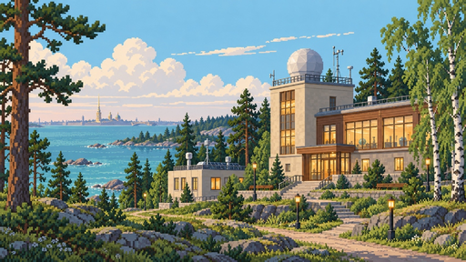
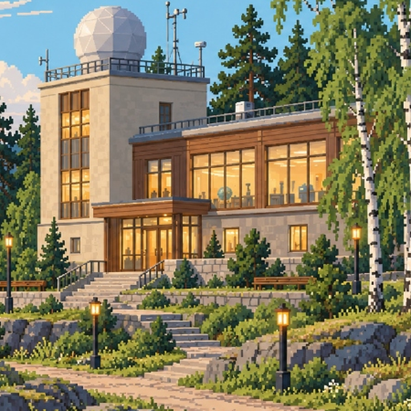
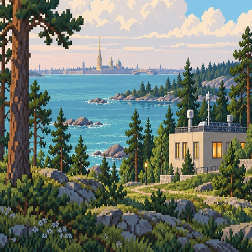
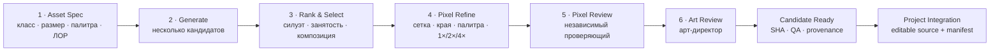
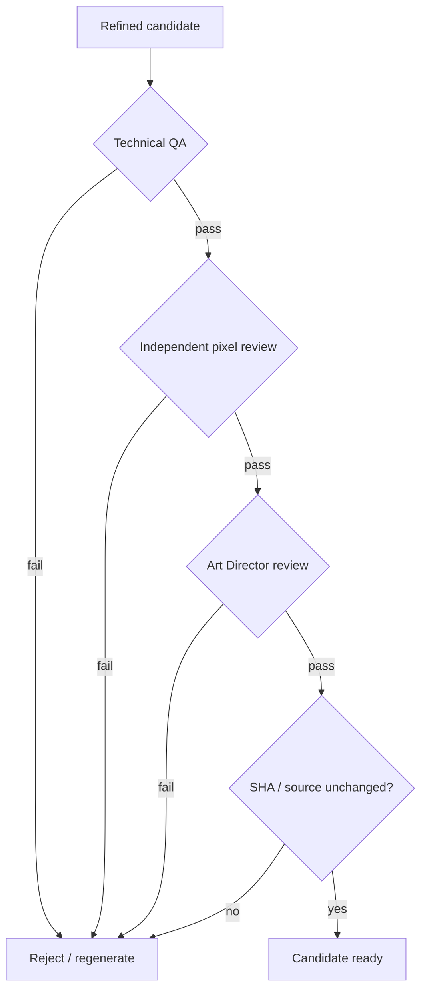
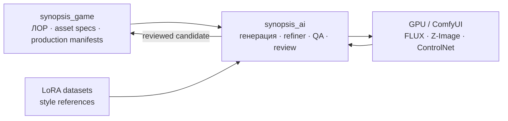

<div align="center">

# 🌦️ Synopsis AI

### Фабрика графики и ИИ-конвейер для **«26063: Позывной „Синоптик“»**

**Генерация → отбор → пиксельный рефайнинг → независимая проверка → арт-дирекция → интеграция**

<p>
  
  
  
  
</p>

<p>
  
  
  
  
  
</p>

<p>
  <a href="https://github.com/f2re/synopsis_ai/stargazers"></a>
  <a href="https://github.com/f2re/synopsis_ai/issues"></a>
  
  
</p>

[**Быстрый старт**](#-быстрый-старт) · [**Конвейер**](#-производственный-конвейер) · [**14 профилей**](#-14-художественных-профилей) · [**MCP**](#-mcp) · [**REST API**](#-rest-api) · [**Структура**](#-структура-репозитория)

</div>

---

<p align="center">
  
  
  
</p>

> [!IMPORTANT]
> **Synopsis AI — не просто генератор картинок.** Репозиторий задаёт воспроизводимый производственный процесс для игровой графики: класс ассета, ограничения композиции, палитру, генерацию кандидатов, пиксельный рефайнинг, техническую проверку и независимую художественную приёмку.

---

## 🎯 Что это за проект

`Synopsis AI` — специализированная инфраструктура генерации ассетов для браузерной обучающей игры **«26063: Позывной „Синоптик“»**.

Проект решает четыре задачи одновременно:

| Контур | Что делает |
|---|---|
| 🎨 **Арт-система** | Хранит 14 специализированных художественных профилей вместо одного универсального промпта |
| 🧠 **Генерация** | Работает с FLUX.2 Klein, Z-Image и резервным SDXL + ControlNet |
| 🧱 **Pixel pipeline** | Нормализует сетку, палитру, края, прозрачность, размеры и варианты масштаба |
| ✅ **QA / review gates** | Разделяет автора, pixel-review и арт-директора и не выдаёт непроверенный PNG за production-исходник |

> [!NOTE]
> Эталонная GPU-конфигурация проекта рассчитана на мощную локальную/удалённую CUDA-ноду. Конкретный адрес сервера не является частью контракта репозитория и задаётся конфигурацией окружения.

---

## 🧭 Главные принципы

<table>
<tr>
<td width="25%"><strong>Art-Purpose-First</strong></td>
<td>Способ генерации и рефайнинга выбирается по назначению ассета, а не применяется одинаково ко всей графике.</td>
</tr>
<tr>
<td><strong>Logical Pixel Grid</strong></td>
<td>Финальный пиксельный размер задаётся контрактом ассета; масштаб 2×/4× — только форма показа, не новая детализация.</td>
</tr>
<tr>
<td><strong>Independent Review</strong></td>
<td>Автор, pixel-reviewer и арт-директор должны быть разными участниками производственного шлюза.</td>
</tr>
<tr>
<td><strong>Provenance</strong></td>
<td>Выбранный кандидат, refined-версия и отчёт связаны SHA-256; изменение изображения аннулирует приёмку.</td>
</tr>
<tr>
<td><strong>No Fake Production</strong></td>
<td>Прошедший QA растр остаётся кандидатом, пока нет редактируемого исходника и интеграции в проектный manifest.</td>
</tr>
</table>

---

## ⚙️ Производственный конвейер



### Жизненный цикл одного ассета

| Шаг | MCP-инструмент | Результат |
|---:|---|---|
| 1 | `asset_spec(asset_id)` | Канонический контракт ассета |
| 2 | `generate_candidates(...)` | Набор сырых кандидатов |
| 3 | `rank_candidates(...)` | Автоматическая оценка и рекомендация |
| 4 | `select_candidate(...)` | Зафиксированный источник |
| 5 | `refine_candidate(...)` | Строгая логическая сетка + варианты 1×/2×/4× |
| 6 | `pixel_art_review(...)` | Независимый pixel-art verdict |
| 7 | `art_review(...)` | Художественный verdict |
| 8 | `approve_asset(...)` | Проверка готовности кандидата к проектной интеграции |

> [!WARNING]
> `approve_asset()` **не должен автоматически превращать один PNG в канонический production source**. Текущий шлюз намеренно блокирует финальное продвижение, пока отсутствуют редактируемый исходник и интеграция в manifest игры.

---

## 🧩 14 художественных профилей

Все классы описаны в [`config/art-generation-profiles.json`](config/art-generation-profiles.json) и доступны через `list_art_profiles()`.

<details open>
<summary><strong>Персонажи и живые объекты</strong></summary>

| Профиль | Назначение | Типовая сетка |
|---|---|---:|
| `dialogue_portrait` | сюжетные портреты | от 192×240 |
| `profile_portrait` | компактные портреты профиля | 160×160 |
| `world_character` | персонаж в игровом мире | 32×48 |
| `companion_sprite` | животные, спутники, фауна | 48×48 |

</details>

<details>
<summary><strong>Архитектура и интерактив</strong></summary>

| Профиль | Назначение | Типовая сетка |
|---|---|---:|
| `architecture_landmark` | большие здания и ориентиры | от 96×96 |
| `architecture_small` | малая архитектура | от 48×48 |
| `interactive_object` | приборы, пульты, рабочие объекты | от 32×32 |
| `prop_sprite` | реквизит и инвентарь | от 24×24 |

</details>

<details>
<summary><strong>Мир, UI и эффекты</strong></summary>

| Профиль | Назначение | Типовая сетка |
|---|---|---:|
| `terrain_tile` | грунт, брусчатка, причал | 32×32 |
| `vegetation_sprite` | северо-западная растительность | от 24×32 |
| `ui_icon` | пиктограммы | от 24×24 |
| `ui_frame` | панели и рамки | от 48×32 |
| `vfx_small` | осадки, дым, малые эффекты | от 16×16 |
| `large_scene` | панорамные сцены | 480×270 |

</details>

---

## 🧠 Модельный стек

Конфигурация моделей находится в [`config/config.yaml`](config/config.yaml).

| Роль | Модель | Назначение |
|---|---|---|
| 🥇 Primary | **FLUX.2 Klein 4B** | основная генерация и редактирование |
| ⚡ Draft | **Z-Image Turbo** | быстрые кандидаты |
| 🧬 LoRA base | **Z-Image Base 6B** | дообучение фирменного стиля |
| 📐 Geometry fallback | **SDXL + ControlNet** | задачи с жёсткой фиксацией геометрии |
| 🎨 Style adapter | `synopsis_26063_style_v1.safetensors` | проектный LoRA-стиль |

> [!TIP]
> Модель — только генератор кандидата. Канонический стиль задаётся совокупностью **asset spec + профиль + палитра + refiner + QA + review gate**.

---

## 🖼️ Датасеты стиля

В репозитории уже хранится набор референсов для LoRA и проверки композиции.

<p align="center">
  
  
  
  
</p>

Основные каталоги:

- [`datasets/master_style_lora/`](datasets/master_style_lora/) — мастер-референсы проектного стиля;
- [`datasets/style_lora/`](datasets/style_lora/) — дополнительные пары изображений/подписей;
- [`palettes/`](palettes/) — палитры пиксельного конвейера;
- [`specs/`](specs/) — локальные контракты ассетов для автономной работы.

---

## 🚀 Быстрый старт

### 1. Клонирование

```bash
git clone https://github.com/f2re/synopsis_ai.git
cd synopsis_ai
```

### 2. Подготовка окружения

```bash
./init_environment.sh
```

Скрипт создаёт виртуальные окружения, runtime-каталоги, проверяет ComfyUI и наличие локальных весов.

### 3. Запуск

```bash
./start_services.sh
```

### 4. Проверка

```bash
./status_services.sh
```

### 5. Остановка

```bash
./stop_services.sh
```

<details>
<summary><strong>Управление через systemd</strong></summary>

```bash
./systemd/install_services.sh

systemctl --user status synopsis-assets-mcp.service
systemctl --user status comfyui.service
systemctl --user restart synopsis-assets-mcp.service
```

</details>

---

## 🔌 MCP

Сервер использует **MCP Streamable HTTP**. Для клиента/IDE достаточно указать адрес GPU-ноды или локального сервера.

```json
{
  "mcpServers": {
    "synopsis-assets": {
      "type": "http",
      "url": "http://<gpu-host>:9200/mcp"
    }
  }
}
```

### Основные MCP-инструменты

```text
list_art_profiles        asset_spec
compile_prompts          generate_candidates
rank_candidates          select_candidate
refine_candidate         preview_asset
pixel_art_review         art_review
check_asset_contract     approve_asset
reject_candidate         regenerate_asset
generate_sprite_frames   generate_day_night_pair
gpu_status               queue_status
```

> [!NOTE]
> `generate_day_night_pair()` в текущей реализации намеренно отключён до появления immutable/provenance-linked candidate IDs для обоих выходов.

---

## 🌐 REST API

Минимальный HTTP-контур доступен поверх того же сервиса:

| Метод | Маршрут | Назначение |
|---|---|---|
| `GET` | `/health` | статус MCP-сервера и Z-Image |
| `GET` | `/api/assets/profiles` | художественные профили |
| `GET` | `/api/assets/spec/{asset_id}` | контракт конкретного ассета |

Пример:

```bash
curl http://127.0.0.1:9200/health
curl http://127.0.0.1:9200/api/assets/profiles
```

---

## ✅ Система приёмки



Проверяется, в частности:

- логический размер и frame grid;
- прозрачность и alpha-контракт;
- палитра и технические ограничения класса;
- сохранность выбранного source candidate;
- SHA refined-версии;
- независимость автора, pixel-reviewer и арт-директора;
- читаемость силуэта;
- возраст и пропорции персонажа;
- материалы и северо-западная атмосфера;
- отсутствие нежелательной chibi/babyface-деформации.

---

## 🗂️ Структура репозитория

```text
synopsis_ai/
├── config/                 # модели, пути и 14 профилей генерации
├── core/                   # генерация, refiner, QA, LoRA, storage, clients
├── datasets/               # наборы для LoRA и визуальные эталоны
├── palettes/               # палитры проекта
├── scripts/                # служебные и модельные сценарии
├── specs/                  # локальные image-spec контракты
├── systemd/                # пользовательские systemd units / installer
├── workflows/              # ComfyUI workflow definitions
├── server.py               # MCP + REST сервер
├── requirements.txt        # Python-зависимости
├── init_environment.sh     # установка окружения
├── start_services.sh       # запуск
├── status_services.sh      # диагностика
└── stop_services.sh        # остановка
```

Runtime-каталоги (`models/`, `output/`, `assets/work/`, `logs/`, virtualenv) создаются локально и не являются каноническим содержимым Git.

---

## 🔗 Связь с `synopsis_game`



`Synopsis AI` должен получать художественный контракт из игрового проекта, но **не имеет права сам менять ЛОР, размеры production-ассета или правила интеграции**.

---

## 🛡️ Эксплуатация и безопасность

> [!CAUTION]
> Конфигурация по умолчанию допускает bind на `0.0.0.0`. Не публикуйте MCP/REST напрямую в интернет без сетевого ограничения, аутентификации или доверенного reverse proxy/VPN.

Рекомендуемая схема:

```text
IDE / Agent
    │
    ▼
VPN / trusted LAN
    │
    ▼
Synopsis MCP :9200
    │
    ├── ComfyUI :8188 (localhost only)
    └── local models / datasets / work storage
```

Не коммитьте в репозиторий API-ключи, приватные токены и локальные абсолютные пути конкретной рабочей станции.

---

## 📌 Текущее состояние

- [x] MCP Streamable HTTP server
- [x] REST health / profiles / asset spec
- [x] 14 художественных профилей
- [x] генерация нескольких кандидатов
- [x] автоматическое ранжирование
- [x] pixel refinement и preview scales
- [x] независимый pixel-review gate
- [x] Art Director gate
- [x] SHA/provenance-проверки
- [x] sprite-sheet pipeline
- [x] LoRA datasets в репозитории
- [x] systemd-управление
- [ ] безопасное production promotion через editable source + manifest
- [ ] повторное включение day/night pair после фиксации provenance обоих выходов
- [ ] полноценный CI для серверного и художественного конвейера

---

## 🧪 Минимальная проверка после развёртывания

```bash
./status_services.sh
curl -fsS http://127.0.0.1:9200/health
```

Затем через MCP:

```text
1. list_art_profiles()
2. asset_spec("<asset_id>")
3. generate_candidates("<asset_id>", count=4)
4. rank_candidates("<asset_id>")
5. select_candidate(...)
6. refine_candidate("<asset_id>")
7. pixel_art_review(...)
8. art_review(...)
9. approve_asset("<asset_id>")
```

---

<div align="center">

### `26063 · Synopsis AI`

**Не «сгенерировать картинку», а собрать воспроизводимый игровой ассет.**

<sub>Связанный проект: <a href="https://github.com/f2re/synopsis_game">f2re/synopsis_game</a></sub>

</div>
