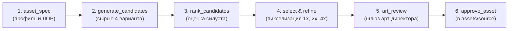

# Фабрика игровых ассетов «Синоптик» (Synopsis AI & MCP Server)

Репозиторий инфраструктуры ИИ-генерации, пиксельного рефайнинга и QA-валидации графики для игры **«26063: Позывной «Синоптик»»** (`https://github.com/f2re/synopsis_ai`).

Сервер развёрнут на удалённой GPU-ноде с 2× NVIDIA GeForce RTX 4090 (24 ГБ VRAM) и предоставляет доступ через **MCP Protocol (v2 Streamable HTTP)** и **REST API**.

---

## 1. Архитектура и 14 независимых профилей графики

Генерационный конвейер строго следует принципу **«Art-Purpose-First»** (зафиксированному в `config/art-generation-profiles.json`): универсальный разрушительный даунсэмплинг запрещён, каждый из 14 классов графики обрабатывается по собственному пайплайну:

1. `dialogue_portrait` — портреты для сюжетных диалогов (от 192×240, 48–96 цветов, высокая читаемость лица и возраста);
2. `profile_portrait` — компактные профильные портреты (160×160, 36–72 цвета);
3. `world_character` — игровые персонажи в мире (32×48, 24–48 цветов);
4. `companion_sprite` — спутники и фауна (48×48, 24–48 цветов);
5. `architecture_landmark` — крупные ориентиры и комплексы станции (от 96×96, 48–96 цветов);
6. `architecture_small` — малая архитектура и будки (от 48×48, 32–72 цвета);
7. `interactive_object` — интерактивные метеоприборы и пульты (от 32×32, 28–64 цвета);
8. `prop_sprite` — предметы инвентаря и реквизит (от 24×24, 24–56 цветов);
9. `terrain_tile` — тайлы грунта, брусчатки и причала (32×32, 24–48 цветов);
10. `vegetation_sprite` — прибалтийская растительность (от 24×32, 28–64 цвета);
11. `ui_icon` — пиктограммы интерфейса (от 24×24, 12–32 цвета);
12. `ui_frame` — рамки и панели окон (от 48×32, 24–56 цветов);
13. `vfx_small` — эффекты осадков и дыма (от 16×16, 16–40 цветов);
14. `large_scene` — панорамные сцены побережья Финского залива (480×270, 96–192 цвета).

---

## 2. Стандартный 6-шаговый жизненный цикл создания ассета



1. **`asset_spec(asset_id)`** — запрос контракта: класс, габариты, палитра, ЛОР, художественные приоритеты и скомпилированные промпты.
2. **`generate_candidates(asset_id, count=4)`** — генерация сырых высокодетализированных вариантов через Z-Image-Turbo / ComfyUI.
3. **`rank_candidates(asset_id)`** — автоматическая оценка силуэта, занятости кадра и композиции; выбор рекомендуемого кандидата.
4. **`select_candidate(asset_id, candidate_id)`** и **`refine_candidate(asset_id)`** — перевод в строгую логическую сетку с сохранением контуров (edge-aware downsampling), очистка шума и квантование по палитре. Создание масштабов **1x, 2x, 4x**.
5. **`art_review(asset_id, status='pass'|'fail', reasons=[...])`** — шлюз арт-директора: проверка читаемости силуэта, материалов, возраста, прибалтийского света, запрет чиби/аниме-деформаций.
6. **`approve_asset(asset_id)`** — перемещение в `approved/` и перенос в production-исходники `assets/source/...` (срабатывает только при совпадении `technical_status=pass` и `art_status=pass`).

---

## 3. Специализированные генераторы

- `generate_sprite_frames(asset_id, frames=...)` — генерация покадровой анимации движения и сборка спрайт-листа.
- `generate_day_night_pair(day_id, night_id)` — генерация пары «День / Ночь» для зданий с пиксельным локом контура фасада.
- `preview_asset(asset_id, scales=[1, 2, 4])` — пути к масштабированным превью.
- `gpu_status()` и `queue_status()` — диагностика GPU и очереди задач.
- `list_art_profiles()` — полный список всех 14 художественных профилей и их правил.

---

## 4. Развёртывание и запуск на GPU-сервере

### Быстрый старт
```bash
# Клонирование репозитория
git clone https://github.com/f2re/synopsis_ai.git /home/user/synopsis-ai
cd /home/user/synopsis-ai

# Инициализация окружения (создание venv, установка зависимостей, ComfyUI)
./init_environment.sh

# Запуск сервисов
./start_services.sh

# Проверка статуса
./status_services.sh

# Остановка
./stop_services.sh
```

### Настройка через systemd
```bash
./systemd/install_services.sh

# Управление через systemctl
systemctl --user status synopsis-assets-mcp.service
systemctl --user status comfyui.service
systemctl --user restart synopsis-assets-mcp.service
```

---

## 5. Подключение к MCP

Для IDE / Agent CLI добавьте в [.mcp.json](file:///Users/meteo/Documents/WWW/synopsis_game/.mcp.json):

```json
{
  "mcpServers": {
    "synopsis-assets": {
      "type": "http",
      "url": "http://10.7.88.12:9200/mcp"
    }
  }
}
```

---

## 6. REST API эндпоинты

- `GET /health` — проверка статуса сервера и доступности Z-Image-Turbo
- `GET /api/assets/profiles` — список всех 14 профилей генерации и политик
- `GET /api/assets/spec/{asset_id}` — контракт, размеры и промпты для конкретного ассета
