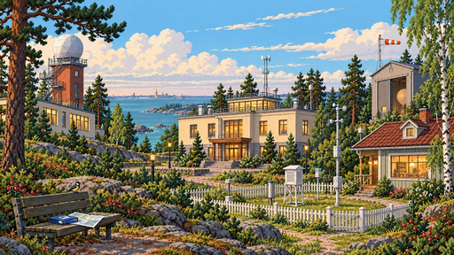
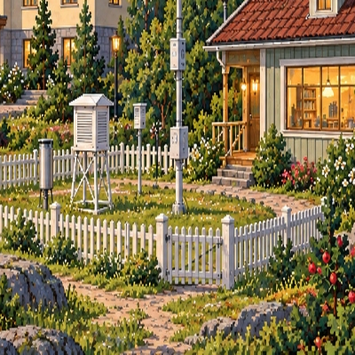
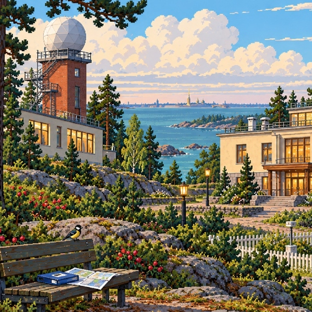
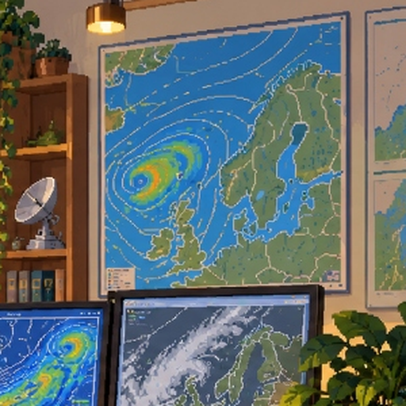
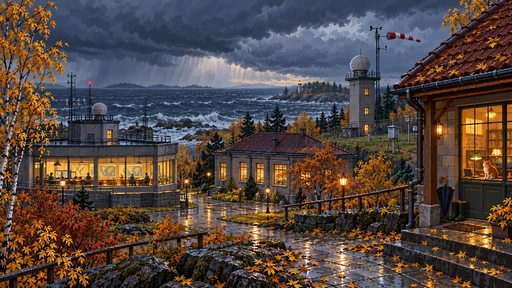

# Эталонный набор 26063 — canonical exemplar pack v1

Этот каталог является **входным шлюзом обучения**, а не ещё одной копией изображений. Он отбирает существующие визуальные материалы `datasets/master_style_lora`, исправляет устаревшие подписи и отделяет три разных статуса:

- `canonical` — разрешено обучать одновременно стилю и миру 26063;
- `style_only` — разрешено использовать только как ориентир пиксельной техники, света, материалов или пропорций; изображение **не создаёт фактов ЛОРа**;
- `excluded` — старый материал, который по умолчанию не попадает в обучение.

Источник истины — репозиторий `f2re/synopsis_game`: `PIXEL_ART_BASELINE_COZY_SCIENCE.md`, `PIXEL_ART_STYLE_GUIDE.md`, `lore-registry.yaml`, `BRAND_AND_LORE_26063.md` и `pixel-art-theme.yaml`.

## Зафиксированный визуальный контракт

- живая сцена: логическая сетка **480×270**;
- мировой персонаж: **32×48**;
- крупный читаемый пиксель, осмысленные кластеры, без случайного однопиксельного шума;
- масштабирование игрового мира — nearest-neighbour;
- плотность сцены: **60 / 30 / 10**;
- локальная поверхность: обычно **3–5 оттенков**;
- минимум **три следа присутствия человека** в обжитой сцене;
- низкий северо-западный горизонт, Финский залив, гранит, сосна/берёза/рябина/шиповник/сирень;
- тёплый человеческий свет противопоставлен холодной балтийской погоде;
- никакой дворцовой монументальности, альпийских гор, тропиков, постапокалипсиса или военно-бункерного языка;
- профессиональные метеорологические цвета и геометрия не являются декоративными эффектами;
- стиль должен быть оригинальным языком `26063`, а не имитацией конкретной коммерческой игры.

## Серия основных эталонов

### 1. Мир и метеоплощадка

| Эталон | Роль |
|---|---|
|  | **EX-WORLD-001** — главный эталон рабочего научного кампуса и метеоплощадки. |
|  | **EX-METEO-001** — приборы должны читаться как функциональное оборудование, а не как декорация. |
|  | **EX-WORLD-002** — берег, гранит, невысокая архитектура, тёплые окна и холодная среда. |
|  | **EX-WORLD-003** — человеческий масштаб дорожек и северо-западная растительность. |

### 2. Научная архитектура

| Эталон | Роль |
|---|---|
|  | **EX-ARCH-001** — белый радиопрозрачный купол, технический силуэт, никакой фантастики и церковной/дворцовой семантики. |
|  | **EX-ARCH-002** — связка радиолокации и аэрологии как части работающего кампуса. |

### 3. Оперативная работа

| Эталон | Роль |
|---|---|
|  | **EX-INT-001** — старое и современное оборудование в одном живом рабочем пространстве. |
|  | **EX-INT-002** — рабочий стол; подпись исправлена: изобары не обучаются как красно-синие декоративные линии, цвета фронтов сохраняют профессиональную семантику. |
|  | **EX-INT-003** — карты являются рабочим аналитическим материалом, а не декоративными постерами. |
|  | **EX-STORY-001** — повествование через следы присутствия человека. |

### 4. Персонажи — только техника и пропорции

| Эталон | Ограничение |
|---|---|
|  | **EX-CHAR-001** — взрослые пропорции, возраст, одежда и пиксельная техника. **Не считать готовой идентичностью Веры Павловны.** |
|  | **EX-CHAR-002** — взрослый профессиональный персонаж. **Не считать готовой идентичностью Семёна Петровича.** |

### 5. Атмосфера — style-only

| Эталон | Ограничение |
|---|---|
|  | **EX-ATM-001** — дождь, мокрый гранит, осень, контраст тёплого и холодного. Архитектура сцены не является каноном кампуса. |
|  | **EX-ATM-002** — материал мокрой поверхности и бытовые следы; коттедж не становится каноническим зданием. |

`station_sea_lighthouse_storm.png` и `station_observation_rotunda.png` остаются в исходном архиве, но в v1 имеют статус `excluded` и в обучение по умолчанию не попадают.

## Сборка набора

Проверить контракт и наличие всех файлов:

```bash
python scripts/build_canonical_exemplar_pack.py --validate-only
```

Собрать только канонические пары `PNG + TXT`:

```bash
python scripts/build_canonical_exemplar_pack.py
```

Добавить к ним безопасные `style_only`-референсы:

```bash
python scripts/build_canonical_exemplar_pack.py --include-style-only
```

Результат создаётся в `datasets/canonical_exemplars/_build/v1/` вместе с `metadata.jsonl` и снимком `canonical_contract.json`.

## Правило аугментации

Автоматическое зеркалирование отключено для канонической выборки. Оно особенно опасно для:

- синоптических карт и подписей;
- приборов с направленной геометрией;
- закреплённой планировки кампуса;
- асимметричных персонажей и уникальных признаков;
- сцен, где берег, входы, лестницы и маршруты имеют смысл.

`flip_allowed=true` в манифесте означает лишь то, что конкретный нейтральный фрагмент **может** быть зеркалирован отдельным осознанным этапом. Builder v1 сам зеркальные копии не создаёт.

## Как добавлять новый эталон

Новый пример принимается только после четырёх проверок:

1. совпадает с логической пиксельной сеткой и языком формы;
2. не создаёт новый факт мира без опоры на `synopsis_game/docs/lore/`;
3. не искажает профессиональную метеорологическую семантику;
4. явно получает `training_use`, `weight`, `anchors`, исправленную `caption_override` и решение по `flip_allowed`.

Так модель обучается не просто «похожей картинке», а различает **стиль**, **канон мира**, **научную достоверность** и **композиционные ограничения**.
